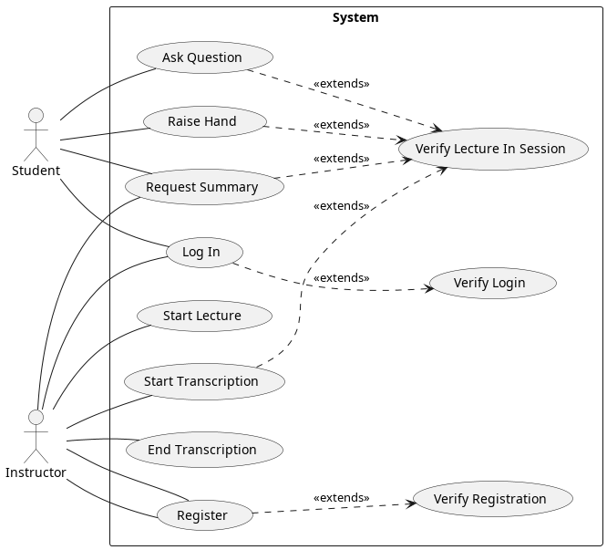

# AI-Hear-You

## Features
- Live transcriptions
- Tool to "virtually" raise your hand - sends a notification to the prof that someone has a question
- Send in questions through the interface
- Summary feature

### Use-Case Diagram
